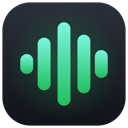
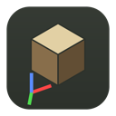
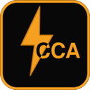
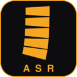

# 🎛️ Audio Projects

**Legend:** 🔧 personal project · 🔒 private project (published website only)

| | Repo | Description | Language |
|:---:|---|---|---|
| 🎚️ | 🔧 [GSR24M-driver](https://github.com/FLORIANSV35/GSR24M-driver) | macOS driver (app + daemon + CoreAudio plug-in) for the Allen & Heath GS-R24 FireWire card, Apple silicon, no kext. **Latest release:** [`v0.5.1`](https://github.com/FLORIANSV35/GSR24M-driver/releases/tag/v0.5.1) | Swift |
|  | 🔧 [SimplePlug](https://github.com/FLORIANSV35/SimplePlug) | Minimal host for a single AU plugin with 2 in / 2 out (macOS). VST3 version for Windows. **Latest release:** [`V26.11.12`](https://github.com/FLORIANSV35/SimplePlug/releases/tag/V26.11.12) | Swift |
|  | 🔧 [Stream-deck-Advance-Audio-Player](https://github.com/FLORIANSV35/Stream-deck-Advance-Audio-Player) | Advanced audio player for Stream Deck (macOS + Windows beta): synchronized multi-track playback, multi-output routing, fades, waveform trim points, live volume. **Latest release:** [`v26.9.104`](https://github.com/FLORIANSV35/Stream-deck-Advance-Audio-Player/releases/tag/v26.9.104) | TypeScript |
|  | 🔧 [Von-De-larsen](https://github.com/FLORIANSV35/Von-De-larsen) | Vocal plugin (AU + VST3 + standalone app with 1 to 8 channels, macOS Apple Silicon): anti-feedback and background noise reduction for live sound vocals. 5.3 ms latency at 48 kHz. **Latest release:** [`v0.2.4`](https://github.com/FLORIANSV35/Von-De-larsen/releases/tag/v0.2.4) | C++ |
|  | 🔧 [3D-to-AI](https://github.com/FLORIANSV35/3D-to-AI) | OBJ → DAE (Collada) converter for Adamson ArrayIntelligence: 3D preview, placement, cropping, macOS `.app` build. **Latest release:** [`V26.10.07`](https://github.com/FLORIANSV35/3D-to-AI/releases/tag/V26.10.07) | Python |
|  | 🔒 CCA (CableCalc Adamson) | Web app for cabling prep of audio/stage gear (Adamson speakers): automatic cable calculation per position, power and signal distribution on racks, prep sheets, PDF/Locasyst export, collaborative project tracking. **Website:** [flosv.fr/cca](https://www.flosv.fr/cca) | PHP / JS |
|  | 🔒 ASR (Array Shoot Reader) | Web app that reads array shoots and draws true-scale cluster and flat sub-array diagrams (box dimensions, spacing, angles), rigging plot, lightweight PDF export. **Website:** [flosv.fr/asr](https://www.flosv.fr/asr) | HTML / JS |

---

[← All my projects](https://github.com/FLORIANSV35) · updated 2026-11-16 · logos taken from the repos themselves, emoji when a repo has no logo
