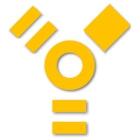
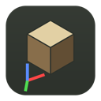

# 📚 Mes projets GitHub

Index de mes dépôts publics ([@FLORIANSV35](https://github.com/FLORIANSV35)) : une courte explication et le lien vers chaque repo.

**Légende :** 🔧 projet personnel · 🍴 fork (modifié ou adapté)

- [🎛️ SON](#️-son)
- [🚁 FPV](#-fpv)

---

## 🎛️ SON

| | Repo | Description | Langage |
|:---:|---|---|---|
| 🎚️ | 🔧 [GSR24M-driver](https://github.com/FLORIANSV35/GSR24M-driver) | Driver macOS (app + daemon + plug-in CoreAudio) pour la carte FireWire Allen & Heath GS-R24, Apple silicon, sans kext. | Swift |
|  | 🍴 [ASFireWire](https://github.com/FLORIANSV35/ASFireWire) | Contrôleur hôte FireWire OHCI en DriverKit pour macOS. ([asfw.net](https://www.asfw.net)) | C++ |
|  | 🔧 [SimplePlug](https://github.com/FLORIANSV35/SimplePlug) | Host minimal pour un seul plugin AU en 2 entrées / 2 sorties (macOS). Version VST3 pour Windows. | Swift |
|  | 🔧 [Stream-deck-Advance-Audio-Player](https://github.com/FLORIANSV35/Stream-deck-Advance-Audio-Player) | Lecteur audio avancé pour Stream Deck (macOS + Windows bêta) : lecture multi-pistes synchronisée, routage multi-sorties, fades, points de trim sur waveform, volume en direct. | TypeScript |
|  | 🔧 [Von-De-larsen](https://github.com/FLORIANSV35/Von-De-larsen) | Plugin vocal (AU + VST3 + app autonome 1 à 8 canaux, macOS Apple Silicon) : anti-larsen et réduction de bruit de fond pour la voix en sono live. Latence 5,3 ms à 48 kHz. | C++ |
|  | 🔧 [3D-to-AI](https://github.com/FLORIANSV35/3D-to-AI) | Convertisseur OBJ → DAE (Collada) pour Adamson ArrayIntelligence : aperçu 3D, placement, recadrage, build `.app` macOS. | Python |

---

## 🚁 FPV

### Analyse spectre & chronométrage (RotorHazard)

| | Repo | Description | Langage |
|:---:|---|---|---|
| 📶 | 🔧 [rotorhazard-rssi-scanner](https://github.com/FLORIANSV35/rotorhazard-rssi-scanner) | Plugin RotorHazard : utilise un node comme analyseur de spectre 5,8 GHz temps réel (spectre, carte des bandes, focus + IM3/IM5, captures). | HTML |
| 🛰️ | 🔧 [Drone-Scan-Tool](https://github.com/FLORIANSV35/Drone-Scan-Tool) | Analyseur de spectre 5,8 GHz et détecteur de balises drone (Remote ID) sur ESP32-S3 + RX5808, avec web app (Web Serial) et mode Timer Backpack RotorHazard. | HTML / Arduino |
| 🏁 | 🍴 [vrxc_elrs](https://github.com/FLORIANSV35/vrxc_elrs) | Intégration du Backpack ExpressLRS dans RotorHazard. | Python |
| 🎒 | 🍴 [Backpack](https://github.com/FLORIANSV35/Backpack) | Firmware pour les backpacks compatibles ExpressLRS. | JavaScript |

### Balises DGAC & contrôle caméra (ESP32-C3)

| | Repo | Description | Langage |
|:---:|---|---|---|
| 📍 | 🔧 [balise-dgac](https://github.com/FLORIANSV35/balise-dgac) | Balise DGAC (Remote ID) en WiFi pour ESP32-C3, alimentée par le GPS d'un FC Betaflight (MSP). | C++ |
| 🎥 | 🔧 [MSP-control-dji-action2](https://github.com/FLORIANSV35/MSP-control-dji-action2) | Contrôle de la DJI Action 2 en BLE (REC à l'armement) + OSD via Backpack ELRS, ESP32-C3. | C++ |
| 📍🎥 | 🔧 [balise-dgac-dji-action2](https://github.com/FLORIANSV35/balise-dgac-dji-action2) | Combine les deux : balise DGAC + contrôle DJI Action 2 (BLE) + OSD Backpack ELRS, fonctions activables. | C++ |

### HDZero

| | Repo | Description | Langage |
|:---:|---|---|---|
|  | 🍴 [graphn-hdzero-goggle-fw](https://github.com/FLORIANSV35/graphn-hdzero-goggle-fw) | Build communautaire non officiel du firmware des lunettes HDZero (Goggle, Goggle2, BoxPro), versionné `graphn`. Flash à vos risques. | C |
|  | 🍴 [graphn-hdzero-vtx](https://github.com/FLORIANSV35/graphn-hdzero-vtx) | Fork du firmware VTX HDZero (MCU 8051 du baseband DM5680). | C |
|  | 🍴 [hdzero-programmer-mac](https://github.com/FLORIANSV35/hdzero-programmer-mac) | Port macOS (Apple Silicon) du programmateur HDZero : onglet VTX via driver libusb CH341. Non validé sur matériel réel. | Python |

---

15 dépôts publics · mis à jour le 2026-11-16 · logos tirés des repos eux-mêmes (stockés dans [logos/](logos/)), emoji quand le repo n'a pas de logo
